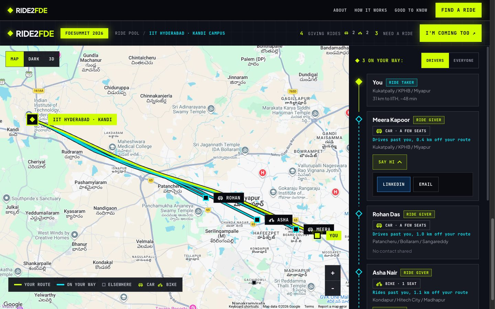
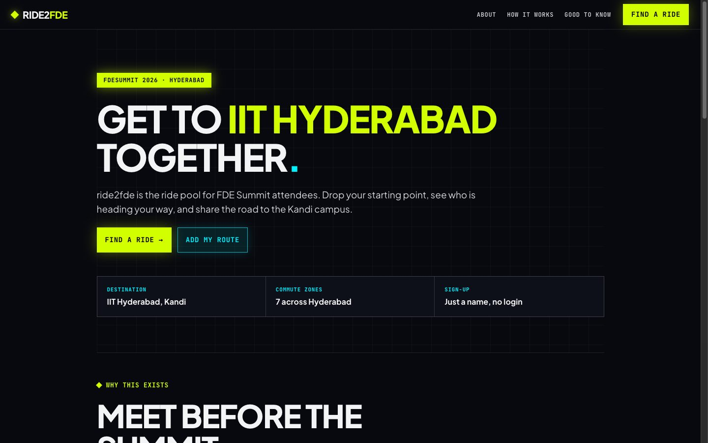
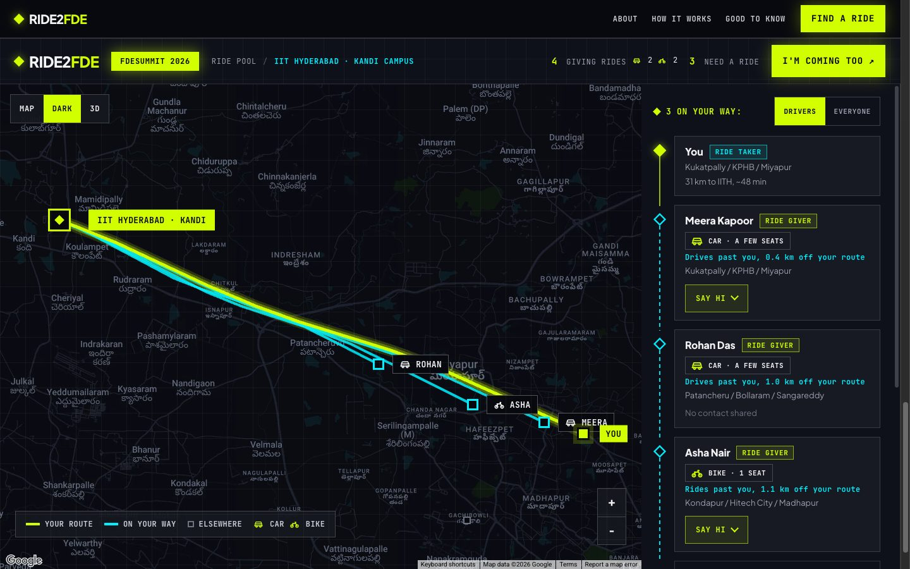
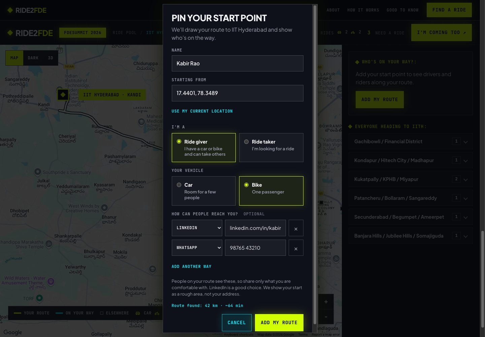
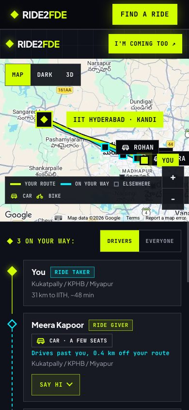

# ride2fde

**Meet before the summit.** ride2fde is a small web app that helps people heading to
[FDE Summit](https://fdesummit.dev/) at **IIT Hyderabad (Kandi campus)** share a ride. You drop your starting
point, the app draws your route to the campus, and it shows you everyone whose route passes near yours, so you can
say hi and arrange the trip.

[](https://github.com/eshwarsgithub/ride2fde/actions/workflows/ci.yml)
[](LICENSE)
[](CONTRIBUTING.md)

**Live:** <https://ride2fde.pages.dev>



## Contents

- [Why it exists](#why-it-exists)
- [How it works](#how-it-works)
- [Features](#features)
- [Screenshots](#screenshots)
- [How matching works](#how-matching-works)
- [Contacts and privacy](#contacts-and-privacy)
- [Tech stack and architecture](#tech-stack-and-architecture)
- [Project structure](#project-structure)
- [API](#api)
- [Data model](#data-model)
- [Run it yourself](#run-it-yourself)
- [Deploy](#deploy)
- [Performance](#performance)
- [Optional: Google Maps view](#optional-google-maps-view)
- [Configuration reference](#configuration-reference)
- [Troubleshooting](#troubleshooting)
- [Known limitations and ideas](#known-limitations-and-ideas)
- [Contributing](#contributing)
- [License](#license)
- [Credits](#credits)

## Why it exists

Kandi is a long way from most of Hyderabad, and many attendees travel from the same few neighbourhoods. Pooling a
ride does three things at once:

- **Networking on the way.** The commute becomes time to meet the people you will spend the day with.
- **Shared cost.** One ride, a shared fare or fuel bill.
- **Less waiting.** Fewer separate cab bookings and less waiting around for them.

## How it works

There are two kinds of people:

| Role | Who | What they do |
|---|---|---|
| **Ride giver** | Someone with a **car** or a **bike** and room for others | Adds their start point and says which vehicle they have |
| **Ride taker** | Someone who needs a ride | Adds their start point |

1. **Add your route.** Press **I'm coming too**, enter your name, your starting area (type it or use your current
   location), pick giver or taker, and optionally add ways to be reached.
2. **We draw your route** to IIT Hyderabad on the map, with distance and time.
3. **See who is on your way.** Anyone whose route passes within about 2 km of yours is listed. Givers see riders in
   the order they would pick them up. Takers see drivers whose route passes near them.
4. **Say hi.** Each match has a **Say hi** dropdown with the ways that person chose to be reached: LinkedIn, email,
   WhatsApp, or a call / text. Agree the pickup point and time there. The app has no chat of its own.

A worked example: **Asha** (a giver on a bike) starts in Miyapur, 50 km from campus. **Ravi** (a taker) starts 25 km
along the same road. Both add their routes. Asha sees "Ravi: pick up about 25 km in, on your route" and Ravi sees
"Asha rides past you, on your route", and each can use the other's contact options.

> The page refreshes every 15 seconds while the tab is open, so a new match appears on its own. There are no push
> notifications or emails yet (see [ideas](#known-limitations-and-ideas)).

## Features

- **Route-based matching** using real driving routes from OSRM (OpenStreetMap routing), not just straight-line
  distance.
- **Ride giver / taker roles**, with **car or bike** shown as an icon and capacity (`Car · a few seats`,
  `Bike · 1 seat`) on cards, map tags, the legend, and the header counts.
- **Contact options in a dropdown**: LinkedIn, email, WhatsApp, phone / SMS. People share only what they choose.
- **Three map views** behind a switch: a standard OpenStreetMap map (default), a dark map styled to match the summit
  site, and a tilted 3D view with buildings. The choice is remembered per browser.
- **No map API keys and no billing.** Maps, address search and routing all run on free OpenStreetMap services.
- **Optional Google Maps view**: with a Google key, a fourth **Google** button shows Google's map, and the app falls
  back to the free map by itself if Google's daily limit is reached (see
  [Optional: Google Maps view](#optional-google-maps-view)).
- **Pickup order** for givers: riders are listed in the order along the giver's route.
- **Zones**: everyone else is grouped by commute area (Gachibowli, Kukatpally, and so on), with your own area first.
- **Rough locations only**: the stored start is rounded to about 300 m and shown as an area name.
- **No login and no accounts**: just a name.
- **Responsive**: works on phones, with the side panel becoming a bottom sheet.

## Screenshots

| Landing page | Dark map |
|---|---|
|  |  |

| Adding a route as a ride giver | On a phone |
|---|---|
|  |  |

The people in the screenshots are made-up demo data.

## How matching works

The rules live in [`shared/geo.ts`](shared/geo.ts) and [`src/match.ts`](src/match.ts).

1. Every route is stored as an **encoded polyline** (the standard compact format, precision 5), simplified to about 60 m accuracy so
   it stays tiny.
2. Two people **match** when either one's **start point is within 2 km of the other's route**
   (`MATCH_RADIUS_KM = 2`). The distance is measured to the nearest point on the route, not just its corners.
3. By default, **givers see takers and takers see givers**. The **Everyone** toggle also shows same-role people.
4. **Order:** a giver's list is in **pickup order** (how far along the giver's own route each rider's start is).
   Everyone else's list is closest first.
5. The map draws your route plus at most the **8 closest** matches. The list shows 12 before "Show more".
6. Because everyone is going to the same place, routes naturally overlap near the campus, which is why the match
   test uses *start points* against *routes*.

If the routing service is unavailable, the app falls back to a **straight line** to the campus so matching still
works, just less precisely.

## Contacts and privacy

What is stored, and what is visible:

| Data | Stored | Who can see it |
|---|---|---|
| Name | Yes | Anyone with the link |
| Start location | Rounded to a ~300 m grid, plus a rough area name such as "Miyapur". The street address typed into the form is never sent. | Anyone with the link |
| Route | Simplified polyline, first point snapped to the rounded start | Anyone with the link |
| Role, vehicle | Yes | Anyone with the link |
| Contact options (LinkedIn, email, WhatsApp, phone) | Yes, only what the person chose to add | The app only shows them on people whose route matches yours, **but see the note below** |

**Important:** there is **no login**, so the app cannot truly hide anything from someone who has the link. The
contact details are returned by the public API and only *displayed* to matches. Treat this as an event tool:

- **Share the link only in closed attendee groups.**
- **LinkedIn is the most privacy-friendly option**, because it doesn't hand out a phone number.
- Only add what you are comfortable sharing.

An earlier design with secret tokens, a "join to see contacts" lock, delete-my-entry and an auto-wipe date was
built and then dropped to keep the app simple. See [ideas](#known-limitations-and-ideas) if you want those back.

**Validation:** the server checks every contact. LinkedIn links must be real `linkedin.com/in/...` profiles, emails
cannot contain characters that could add extra recipients to a mail link, and phone numbers are reduced to digits
with a country code (a bare 10-digit number is treated as Indian). Links are rebuilt from the validated value when
shown, never taken as typed.

## Tech stack and architecture

| Layer | Choice |
|---|---|
| Frontend | Vanilla **TypeScript** + **Vite**. No UI framework. |
| Maps | **MapLibre GL JS** with **OpenFreeMap** vector tiles (OpenStreetMap data). No key. |
| Address search | **Photon** (komoot), an OpenStreetMap geocoder: search-as-you-type and "use my location". No key. |
| Routing | **OSRM** public server, the router behind openstreetmap.org's directions. No key. |
| Optional map | **Google Maps JavaScript API**, only if built with a key ([details](#optional-google-maps-view)) |
| Backend | **Cloudflare Pages Functions** (one function, `functions/api/attendees.ts`) |
| Database | **Cloudflare D1** (SQLite), schema managed by migrations |
| Hosting | **Cloudflare Pages** |
| Fonts | Plus Jakarta Sans and JetBrains Mono, self-hosted via Fontsource |

```text
 Browser (Vite + TypeScript)                      Cloudflare Pages
 ┌──────────────────────────────────┐            ┌──────────────────────────┐
 │ index.html  landing page + app   │            │ functions/api/           │
 │ src/main.ts   boot, polling      │  /api/...  │   attendees.ts           │
 │ src/form.ts   add-route dialog   │───────────▶│   GET  list              │
 │ src/route.ts  OSRM driving route │            │   POST validate + save   │
 │ src/match.ts  who is on my way   │            └────────────┬─────────────┘
 │ src/panel.ts  the side panel     │                         │
 │ src/map.ts    MapLibre map       │                         ▼
 │ src/search.ts Photon search      │            ┌──────────────────────────┐
 │ src/map-google.ts  optional view │            │                          │
 └───────────┬──────────────────────┘            │ D1 (SQLite)              │
             │                                   │   table: attendees       │
             ▼                                   └──────────────────────────┘
   OpenStreetMap services, no keys
   (map files from this site, Photon search, OSRM routes)
   + optionally Google Maps JavaScript API, only for the Google view

 shared/   code used by both sides: zones, polylines, contact rules, types
```

**Data flow when someone adds a route**

1. The browser asks OSRM for the driving route from the chosen start to the campus.
2. The route is simplified, and the form data is `POST`ed to `/api/attendees`.
3. The function validates everything, rounds the start to the grid, assigns a **zone** (nearest zone centre),
   stores a row in D1, and returns it.
4. Every browser re-fetches the list every 15 seconds, computes matches locally, and redraws only what changed.

A few design notes:

- **Matching runs in the browser** from the public list. With event-sized data (hundreds of people) that is fast,
  and it keeps the server trivial.
- **The map is behind an interface** ([`src/map-view.ts`](src/map-view.ts)). One MapLibre map serves all three
  looks: the dark one is the same OpenFreeMap style recoloured in code, and 3D tilts the camera and raises buildings.
- **Zones** are seven hand-picked commute areas along the routes into Kandi (plus an unused "other"), assigned by
  nearest centre. They are a grouping aid, not a clustering algorithm.

## Project structure

```text
.
├── index.html               Landing page + the app (map, panel, form dialog) in one page
├── functions/
│   └── api/attendees.ts     The whole backend: GET list, POST create
├── migrations/              D1 schema, applied in order
│   ├── 0001_init.sql        attendees table
│   ├── 0002_roles_routes.sql  role + route, drops mode/pooling
│   ├── 0003_contacts.sql    contact options replace the single phone number
│   └── 0004_vehicle.sql     car / bike for ride givers
├── scripts/
│   └── fetch-map-assets.mjs  Downloads the region's map tiles, fonts and icons into public/map/
├── public/
│   ├── _headers             Cloudflare Pages caching and content-type rules
│   └── favicon.svg
├── shared/                  Used by both the browser and the function
│   ├── contacts.ts          Contact types, validation, link building
│   ├── geo.ts               Polyline encode/decode, distance to a route, simplification, match radius
│   ├── server.ts            Small helpers for the function (location rounding, JSON replies)
│   ├── map-region.json      The area the map covers and the map-data version
│   ├── types.ts             Attendee, roles, vehicles
│   └── zones.ts             The venue, the seven zones, haversine distance
├── src/
│   ├── main.ts              Boot, polling, switching maps, wiring the panel
│   ├── form.ts              The "I'm coming too" dialog (location, role, vehicle, contacts)
│   ├── route.ts             Driving route from OSRM (with straight-line fallback)
│   ├── search.ts            Address search and reverse lookup (Photon), the suggestion list
│   ├── match.ts             Who is on whose route
│   ├── panel.ts             The side panel: route line, matches, "Say hi", zone lists
│   ├── map-view.ts          The interface every map implements, plus shared colours
│   ├── map.ts               The MapLibre map: standard, dark and 3D looks, pins, route lines
│   ├── map-style.json       OpenFreeMap's Liberty style, adapted at runtime to use our own map files
│   ├── map-google.ts        The optional Google Maps view, with fallback to the free map
│   ├── icons.ts             Car and bike icons
│   ├── api.ts               fetch wrappers for the API
│   └── style.css            All styling (design tokens at the top)
├── docs/screenshots/        Images used in this README
├── wrangler.toml            Cloudflare config (D1 binding, Pages output folder)
└── vite.config.ts           Dev server (proxies /api to the Functions dev server), build chunking
```

## API

Base URL: the site itself (`/api`). There is no authentication.

### `GET /api/attendees`

Returns everyone, ordered by zone and then distance.

```json
{
  "attendees": [
    {
      "id": 7,
      "name": "Asha Nair",
      "role": "giver",
      "vehicle": "bike",
      "address": "Miyapur",
      "lat": 17.488,
      "lng": 78.39,
      "zone": "kukatpally",
      "route_polyline": "sgmiBsoe}M...",
      "distance_km": 31,
      "eta_min": 48,
      "contacts": [{ "type": "whatsapp", "value": "919876511111" }],
      "created_at": "2026-11-26 09:12:44"
    }
  ]
}
```

### `POST /api/attendees`

Adds one person. Responds `201` with `{ "attendee": { ... } }`.

| Field | Required | Notes |
|---|---|---|
| `name` | yes | 1 to 80 characters |
| `role` | yes | `"giver"` or `"taker"` |
| `vehicle` | for givers | `"car"` or `"bike"`. Ignored for takers. |
| `lat`, `lng` | yes | Valid coordinates. Stored rounded to a ~300 m grid. |
| `address` | no | A rough area name (max 80 chars). Defaults to the zone's name. |
| `route_polyline` | no | Encoded polyline. If missing or invalid, a straight line is stored. |
| `distance_km`, `eta_min` | no | Numbers from the browser's route lookup |
| `contacts` | no | Up to four items `{ "type", "value" }`, one per type. Empty values are ignored. |

Contact types: `linkedin`, `email`, `whatsapp`, `phone`. Values are normalised: LinkedIn becomes
`https://www.linkedin.com/in/<handle>`, email is lower-cased, phone and WhatsApp become digits with a country code.

Errors return `400` with `{ "error": "..." }`, for example `vehicle must be car or bike`,
`Check the LinkedIn details`, or `Use WhatsApp only once`.

```bash
curl -X POST https://ride2fde.pages.dev/api/attendees \
  -H 'content-type: application/json' \
  -d '{"name":"Asha","role":"giver","vehicle":"bike","lat":17.49,"lng":78.39,
       "contacts":[{"type":"linkedin","value":"linkedin.com/in/asha-nair"}]}'
```

> Please don't use that command against the live site for testing: it adds a real entry. Use your own local copy
> (see below).

## Data model

One table, `attendees`, built up by the four migrations:

| Column | Type | Meaning |
|---|---|---|
| `id` | integer, primary key | |
| `name` | text | |
| `role` | text | `giver` or `taker` |
| `vehicle` | text, nullable | `car` or `bike` for givers, `NULL` for takers |
| `address` | text | A rough area name, never a street address |
| `lat`, `lng` | real | Start, rounded to a ~300 m grid |
| `zone` | text | Nearest zone id, set by the server |
| `route_polyline` | text | Encoded route from the start to the campus |
| `distance_km`, `eta_min` | real, nullable | Driving distance and time at the moment of adding |
| `contacts` | text (JSON) | `[{ "type", "value" }]` |
| `created_at` | text | UTC timestamp |

Index: `idx_attendees_zone` on `zone`.

## Run it yourself

### Prerequisites

- **Node.js 22.12 or newer** (an `.nvmrc` is included, so `nvm use` picks the right one)
- A **Cloudflare** account (free tier is enough)

No map API key is needed: the map, search and routing use free OpenStreetMap services.

### 1. Install

```bash
git clone https://github.com/eshwarsgithub/ride2fde.git
cd ride2fde
npm install
npm run map:assets   # downloads the map data for Greater Hyderabad (~38 MB) into public/map/, once
```

The map's tiles, label fonts and icons are served from the site itself rather than a third-party server (see
[Performance](#performance)), so they have to be downloaded once. The folder is git-ignored.

### 2. Create the database

```bash
npx wrangler login
npx wrangler d1 create ride2fde-db
```

Copy the `database_id` it prints into **two places**, which must match:

- `wrangler.toml` → `database_id`
- `package.json` → the `pages:dev` script (`--d1=DB=<database_id>`)

Then apply the migrations to the local database:

```bash
npm run db:migrate:local
```

### 3. Start the two dev servers

```bash
npm run build        # once, so the Functions server has files to serve
npm run pages:dev    # terminal 1: the API + local D1 on http://localhost:8788
npm run dev          # terminal 2: the app with hot reload on http://localhost:5173
```

Open <http://localhost:5173>. Vite proxies `/api` to the Functions server on port 8788.

### Useful scripts

| Command | What it does |
|---|---|
| `npm run dev` | Vite dev server (the app) on :5173 |
| `npm run pages:dev` | Cloudflare Pages dev server (API + local D1) on :8788 |
| `npm run typecheck` | Type-check the app and the server function |
| `npm run build` | Type-check the app and build to `dist/` |
| `npm run map:assets` | Download the map tiles, fonts and icons for the region into `public/map/` (skips files it has) |
| `npm run preview` | Preview the production build |
| `npm run db:migrate:local` | Apply migrations to the local database |
| `npm run db:migrate:remote` | Apply migrations to the live database |
| `npm run deploy` | Fetch any missing map data, build, and deploy to Cloudflare Pages |

## Deploy

```bash
npx wrangler login
npx wrangler pages project create ride2fde --production-branch main   # once
npm run db:migrate:remote                                              # before every deploy that adds a migration
npm run deploy
```

Notes:

- **Apply remote migrations before deploying** a version that needs them, or the live API will error.
- Use a different project name if `ride2fde` is taken on your Cloudflare account, and update `name` in
  `wrangler.toml`.

## Performance

The page is built to load fast on a phone in India:

- **Map data comes from our own site.** The vector tiles for Greater Hyderabad, the label fonts and the icon sprites
  are downloaded once (`npm run map:assets`) and deployed with the site, so they come from the nearest Cloudflare edge
  over the page's own connection. OpenFreeMap's public server answered from Europe, and the map needed a chain of
  four round trips to it before drawing anything. The style is bundled into the app instead of fetched.
- **The people list doesn't wait for the map.** MapLibre (most of the JavaScript) loads in parallel, so the list shows
  first and the map catches up.
- **Fonts are self-hosted** (Fontsource), with no Google Fonts round trip.
- **Hints in the HTML**: the map code and main fonts are preloaded, and the search and routing servers preconnected.
  Cloudflare Pages turns the preloads into Early Hints.
- **Caching** ([`public/_headers`](public/_headers)): hashed build files and the versioned map data are cached by the
  browser for a year, and tiles are sent as `application/x-protobuf` so Cloudflare compresses them.

Measured locally on a simulated 4G connection: the people list appears in about 0.4 s (was 2.2 s) and the map in
about 0.7 s (was 2.3 s).

The map covers the box in [`shared/map-region.json`](shared/map-region.json), and the view can't be moved outside it.
To cover a different area or refresh the data, change that file (the `version` is OpenFreeMap's planet build) and run
`npm run map:assets` again.

## Optional: Google Maps view

The app's main map is the free OpenStreetMap one above, and it needs no key. You can **also** offer Google's map: build
the site with a Google Maps key and a **Google** button appears next to Map / Dark / 3D. This is how the app worked
before it moved to OpenStreetMap, kept as an option for when a Google key with quota is available.

**What it does and doesn't change**

- Only the map picture changes. Pins, route lines, the legend and the zoom buttons look the same on both.
- Address search (Photon), routing (OSRM) and the data stay on the free OpenStreetMap services, so Google quota is
  spent only on map loads, and only by people who press the button.
- Google's script is downloaded only when someone picks the Google view. Without a key, nothing about Google is
  loaded and the button stays hidden.
- **If Google refuses** (daily limit reached, billing off, wrong key), the app notices Google's "Oops! Something went
  wrong" error, switches back to the free map, shows a short note, and disables the button for that visit. People
  never get stuck on Google's error.

**Previous Google architecture (for reference)**

Before the switch, Google Maps Platform did everything:

| Feature | Google API it used | Now (default) |
|---|---|---|
| Map (standard, dark) | Maps JavaScript API | MapLibre + OpenFreeMap tiles served from this site |
| 3D map | Maps JavaScript API, photorealistic 3D (`gmp-map-3d`) | MapLibre tilted, with raised buildings |
| Address search | Places API (Autocomplete) | Photon |
| "Use my location" | Geocoding API | Photon reverse lookup |
| Driving routes | Routes API | OSRM |

```text
 Browser ──▶ Google Maps Platform (one API key, billing account required)
             Maps JavaScript API · Places · Geocoding · Routes
```

It was dropped as the default because Google requires a billing account even for its free monthly allowance, and the
no-billing demo key ran out of its daily quota during use. The optional view uses only the **Maps JavaScript API**.

**Turning it on**

1. In [Google Cloud Console](https://console.cloud.google.com/google/maps-apis), use a project with **billing enabled**
   (Google's monthly free allowance per API still applies), or the Maps demo key (small daily limit, not for
   production).
2. Enable the **Maps JavaScript API** and create an **API key**.
3. Restrict the key: *Application restrictions* → **HTTP referrers**, for example `https://your-site.example/*` and
   `http://localhost:5173/*`; *API restrictions* → **Maps JavaScript API** only. An unrestricted key can be used on
   anyone's site at your cost.
4. Put it in `.env` (copy [`.env.example`](.env.example)):
   ```bash
   VITE_GOOGLE_MAPS_API_KEY=your-key
   ```
5. Build and deploy as usual (`npm run deploy`). The key is read **at build time** and ends up in the page, which is
   normal for browser Maps keys; that's why the referrer restriction matters. To turn the Google view off, empty the
   value and deploy again.

## Configuration reference

| Setting | Where | Purpose |
|---|---|---|
| `DB` (D1 binding) | `wrangler.toml` | The database the function reads and writes |
| `database_id` | `wrangler.toml` and the `pages:dev` script | Must match in both |
| `MATCH_RADIUS_KM` | `shared/geo.ts` | How close counts as "on the same route" (2 km) |
| `ROUTE_TOLERANCE_KM` | `shared/geo.ts` | Route simplification accuracy (0.06 km) |
| `GRID_DEG` | `shared/server.ts` | Location rounding (0.003°, about 300 m) |
| `POLL_MS` | `src/main.ts` | How often the page refreshes (15 s) |
| `ZONES`, `VENUE` | `shared/zones.ts` | The commute areas and the destination |
| Map area and data version | `shared/map-region.json` | The region the map covers and ships tiles for |
| `VITE_GOOGLE_MAPS_API_KEY` | `.env` (build time), optional | Turns on the Google map view. Empty = hidden |

To reuse this for another event, change `VENUE` and `ZONES` in `shared/zones.ts` and the copy in `index.html`.

## Troubleshooting

| Problem | Likely cause and fix |
|---|---|
| `no such table: attendees` when running locally | Migrations not applied, or `pages:dev` uses a different database id. Run `npm run db:migrate:local` and make sure the id in `package.json` matches `wrangler.toml`. |
| The map is blank or labels are missing | The map data isn't downloaded. Run `npm run map:assets`, then build again. |
| The page loads but the API returns 500 after deploying | A migration is missing on the live database. Run `npm run db:migrate:remote`. |
| "Use my current location" fills in coordinates, not a place name | Photon didn't answer. The app still works: the server falls back to the zone's name. |
| The route is a straight line | The public OSRM server didn't answer (it is fair-use, with no uptime guarantee). Try again later. |
| 3D map is slow | Switch to the standard or dark map. The 3D view draws the most. |
| The Google button is missing | The site was built without `VITE_GOOGLE_MAPS_API_KEY`. Add it to `.env` and build again. |
| The Google button is greyed out | Google refused this visit (daily limit, billing or key restrictions). The free map is shown instead; it resets on reload. |
| Address search finds nothing | Photon searches OpenStreetMap within Greater Hyderabad. Try a nearby area or landmark name. |

## Known limitations and ideas

**Limitations**

- **No login.** Anything people add is visible to anyone with the link (see
  [Contacts and privacy](#contacts-and-privacy)).
- **No departure time.** Two people can match on route but travel at different hours, and the app can't tell.
- **No notifications.** You see new matches only while the page is open (it refreshes every 15 seconds).
- **No edit or delete** of your own entry.
- **The distance and time are a single estimate** made when you add your route, without traffic.
- **Search and routing use free public servers** (Photon, OSRM) on a fair-use basis, with no uptime guarantee.
  For a big event, self-host them or move to a paid plan.
- **Zones are hand-picked** and tuned to the routes into Kandi.
- **No automated test suite.** Behaviour was checked by hand and with scripted browser runs.

**Ideas**

- An optional **departure time**, with matches limited to people leaving around the same time.
- A **"new match" alert** while the tab is open, then web push for phones.
- **Edit / delete my entry**, possibly with a secret kept in the browser, and an **auto-wipe** date after the summit.
  (A token-based version of this was built and removed for simplicity.)
- A shared **passcode** on the API so only attendees can read it.
- Add tests for the matching and contact-validation code in `shared/`.

## Contributing

ride2fde is **open source** and contributions are very welcome, from a typo fix to a new feature.

**The short version**

1. **Fork** the repository and create a branch.
2. Make your change and run `npm run typecheck && npm run build`.
3. **Open a pull request.** CI runs the same checks automatically, and the maintainer reviews it.

Please read [CONTRIBUTING.md](CONTRIBUTING.md) first: it covers setup, conventions, the pull request checklist and
a few things to avoid. By taking part you agree to the [Code of Conduct](CODE_OF_CONDUCT.md). Found a security
problem? Please report it privately, as described in [SECURITY.md](SECURITY.md).

**Where to start**

Good first contributions, roughly from smallest to biggest:

- **Try it on your phone or browser** and open an issue for anything that looks or behaves wrong.
- **Improve the docs**: anything in this README that confused you.
- **Add tests** for the pure functions in `shared/` (`geo.ts` for matching and polylines, `contacts.ts` for
  validation). There is no test suite yet, so this is a valuable first one.
- **Accessibility pass**: keyboard use, screen readers, colour contrast.
- **Departure time**: let people say when they leave, and match only people leaving around the same time.
- **A "new match" alert** while the tab is open.
- **Edit and delete my entry.**

Open an issue before starting anything large, so we can agree on the approach.

**Your own copy**

Anyone can run their own instance, for example for a different event: change `VENUE` and `ZONES` in
`shared/zones.ts` and the copy in `index.html`, then follow [Run it yourself](#run-it-yourself) and
[Deploy](#deploy). You'll need a Cloudflare account; no map keys.

## License

[MIT](LICENSE), copyright (c) 2026 Eshwar Vemula. You are free to use, copy, modify and share this code, as long as the
license notice stays with it. Map data is © OpenStreetMap contributors, available under the
[Open Database License](https://www.openstreetmap.org/copyright).

## Credits

Built with love for the community by [Eshwar Vemula](https://www.veshwar.dev/).

The visual style follows [fdesummit.dev](https://fdesummit.dev/). Map data © [OpenStreetMap](https://www.openstreetmap.org/copyright) contributors. Tiles by
[OpenFreeMap](https://openfreemap.org), search by [Photon](https://photon.komoot.io), routing by
[OSRM](https://project-osrm.org), drawn with [MapLibre](https://maplibre.org).
This is an independent community tool and is not an official part of FDE Summit.
